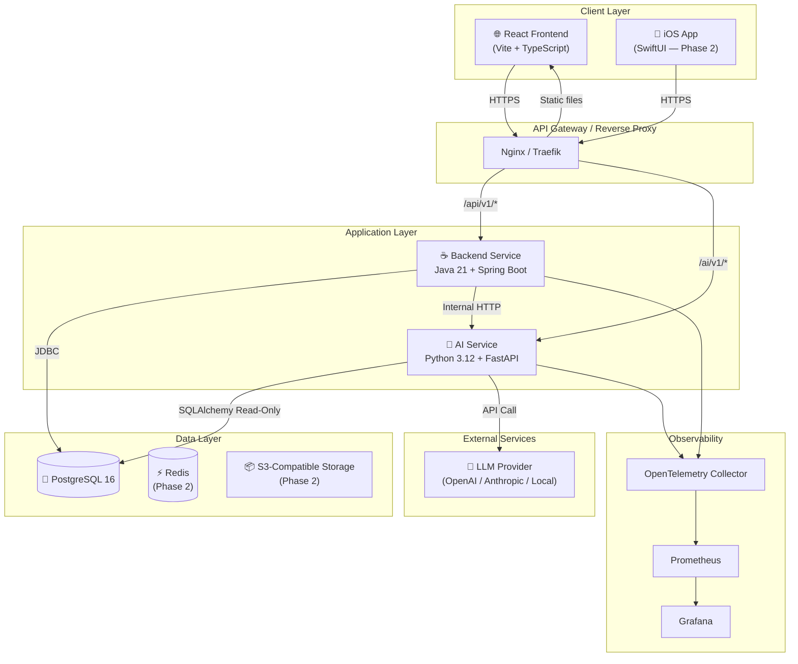
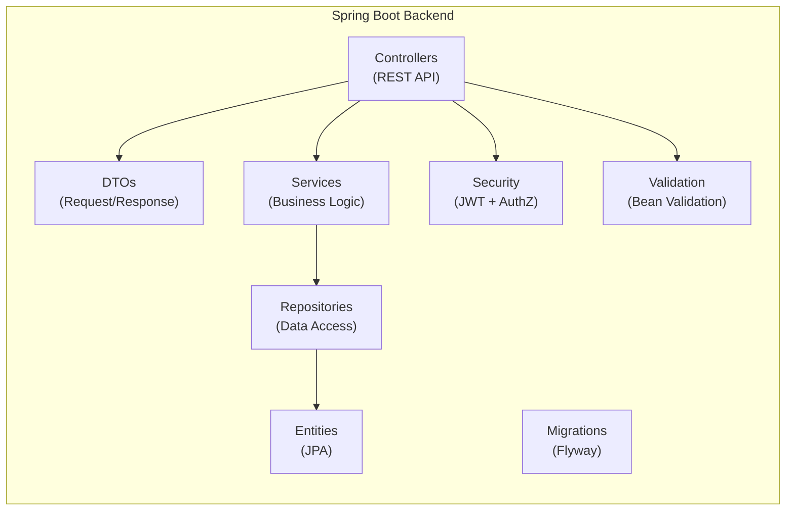
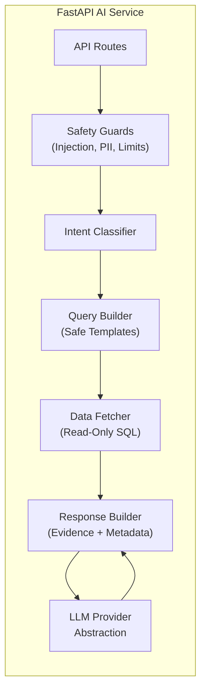
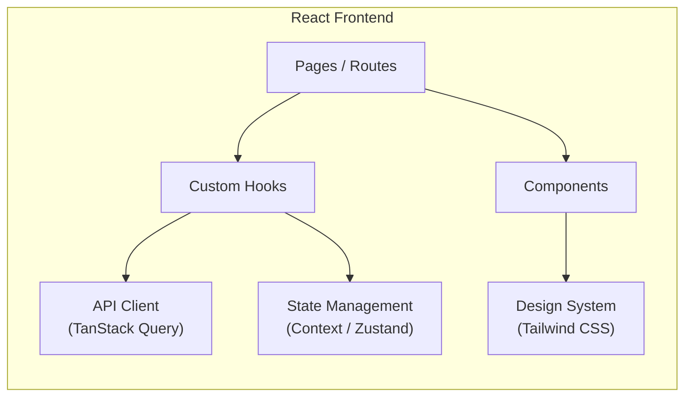
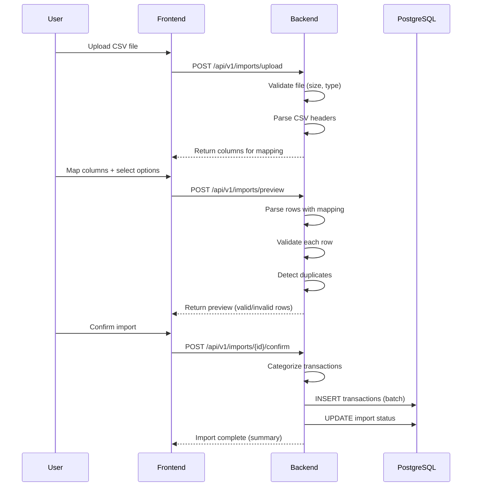
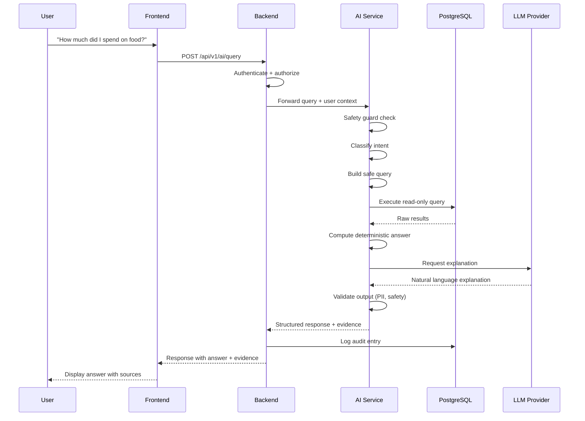
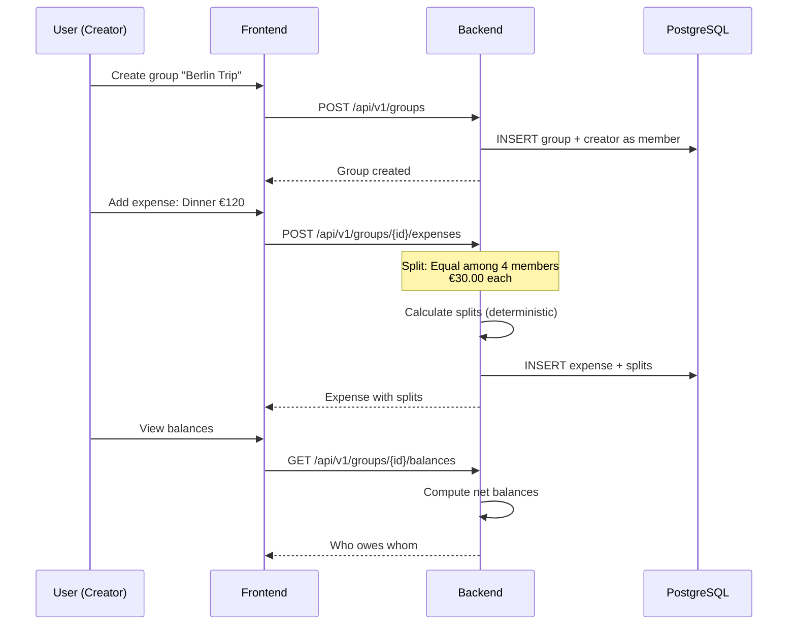
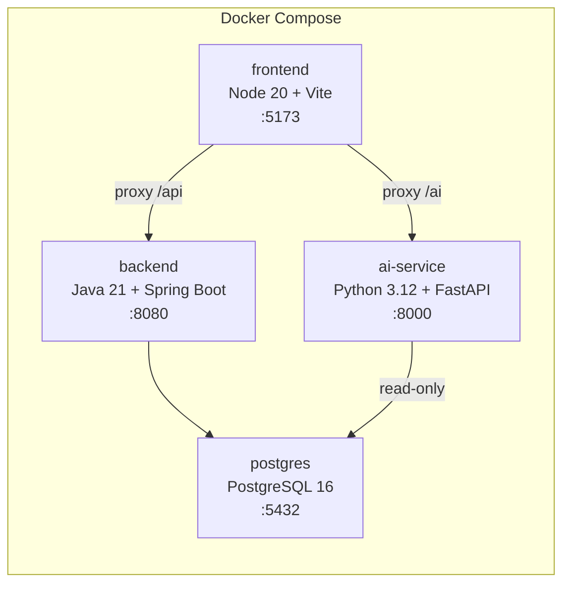
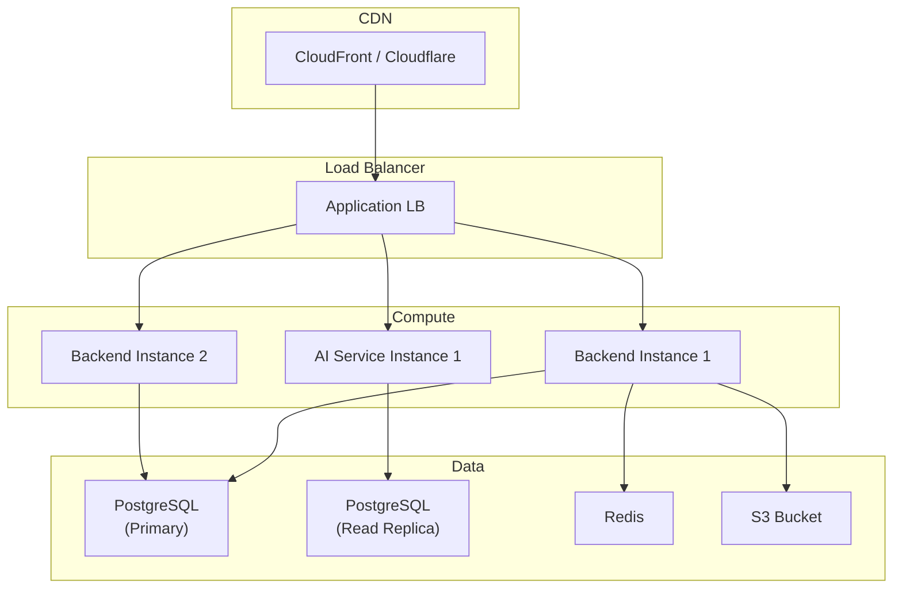
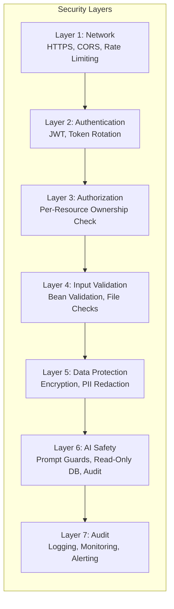

# Mosaic — Architecture Document

## 1. System Overview

Mosaic follows a **modular monorepo** architecture with three primary services and a shared database.



## 2. Service Architecture

### 2.1 Backend Service (Java / Spring Boot)

The backend is the **single source of truth** for all business logic, financial calculations, and data integrity.



**Package Structure:**

```
com.mosaic
├── config/              # Spring configuration, security, CORS
├── common/
│   ├── dto/             # Shared DTOs (ErrorResponse, PageResponse)
│   ├── exception/       # Custom exceptions + global handler
│   ├── model/           # Shared value objects (Money, Currency)
│   └── util/            # Date, money, string utilities
├── auth/
│   ├── controller/
│   ├── dto/
│   ├── service/
│   ├── entity/
│   └── repository/
├── transaction/
│   ├── controller/
│   ├── dto/
│   ├── service/
│   ├── entity/
│   ├── repository/
│   └── importer/        # CSV import logic
├── category/
│   ├── controller/
│   ├── dto/
│   ├── service/
│   ├── entity/
│   └── repository/
├── categorization/
│   ├── service/          # Rule engine, merchant alias matcher
│   ├── entity/
│   └── repository/
├── recurring/
│   ├── controller/
│   ├── dto/
│   ├── service/
│   ├── entity/
│   └── repository/
├── group/
│   ├── controller/
│   ├── dto/
│   ├── service/
│   ├── entity/
│   └── repository/
├── savings/
│   ├── controller/
│   ├── dto/
│   ├── service/
│   ├── entity/
│   └── repository/
├── dashboard/
│   ├── controller/
│   ├── dto/
│   └── service/
├── insight/
│   ├── controller/
│   ├── dto/
│   ├── service/
│   └── entity/
├── ai/
│   ├── controller/       # Proxy to AI service
│   ├── dto/
│   └── client/           # HTTP client for AI service
└── audit/
    ├── entity/
    ├── repository/
    └── service/
```

### 2.2 AI Service (Python / FastAPI)

The AI service handles **intent classification, LLM orchestration, and explanation generation**. It does NOT own financial calculations.



**Package Structure:**

```
ai_service/
├── main.py                # FastAPI app
├── config.py              # Settings
├── api/
│   ├── routes.py          # API endpoints
│   └── models.py          # Pydantic request/response models
├── intent/
│   ├── classifier.py      # Intent classification
│   └── intents.py         # Intent definitions
├── query/
│   ├── builder.py         # Safe query builder
│   └── templates.py       # Query templates
├── data/
│   ├── fetcher.py         # Read-only data access
│   └── connection.py      # DB connection (read-only)
├── llm/
│   ├── provider.py        # Abstract LLM provider
│   ├── openai_provider.py # OpenAI implementation
│   ├── mock_provider.py   # Mock for testing
│   └── prompts.py         # System prompts
├── safety/
│   ├── guards.py          # Input/output validation
│   ├── pii_filter.py      # PII detection/redaction
│   └── injection.py       # Prompt injection detection
├── evaluation/
│   ├── dataset.py         # Evaluation dataset
│   └── runner.py          # Evaluation runner
└── tests/
```

### 2.3 Frontend (React + TypeScript)



## 3. Data Flow Architecture

### 3.1 Transaction Import Flow



### 3.2 AI Query Flow



### 3.3 Shared Expense Flow



## 4. Infrastructure Architecture

### 4.1 Local Development (Docker Compose)



### 4.2 Production Architecture (Future)



## 5. Security Architecture



### Key Security Decisions

| Decision | Approach |
|---|---|
| Password storage | bcrypt with cost factor 12 |
| Authentication | JWT (short-lived access + refresh tokens) |
| Authorization | Ownership check on every repository query |
| Money storage | BIGINT minor units — never float/double |
| AI database access | Separate read-only connection |
| AI queries | Intent router + safe templates — no arbitrary SQL |
| File uploads | Size limit, type whitelist, content scanning |
| Secrets | Environment variables — never in source code |
| Audit | Structured logs + audit_logs table |

## 6. Key Architecture Decisions (ADRs)

### ADR-001: Monorepo Structure
**Decision:** Use a single Git repository with separate service directories.
**Rationale:** Simplifies dependency management, CI/CD, and cross-service refactoring for a small team. Can split later if team grows.

### ADR-002: Separate AI Service
**Decision:** Run AI/LLM logic as a separate Python FastAPI service, not embedded in the Java backend.
**Rationale:** Python has the strongest ecosystem for ML/NLP. Separation allows independent scaling, language-optimal tooling, and clear security boundary (read-only DB access).

### ADR-003: Money as Integer Minor Units
**Decision:** Store all monetary values as `BIGINT` representing the smallest currency unit (cents, paise, etc.).
**Rationale:** Floating-point arithmetic causes rounding errors in financial calculations. Integer arithmetic is deterministic and exact.

### ADR-004: Backend Owns All Financial Calculations
**Decision:** The backend service performs all financial computations. The AI service only explains pre-computed results.
**Rationale:** LLMs are non-deterministic. Financial calculations must be reproducible and auditable. The AI service receives computed data and generates natural-language explanations.

### ADR-005: Intent Router over Text-to-SQL
**Decision:** Use an intent classification + safe query template approach instead of text-to-SQL.
**Rationale:** Text-to-SQL is a major security risk (SQL injection, data leakage). Intent routing limits queries to a known-safe set and is more predictable for an MVP.

### ADR-006: Flyway for Database Migrations
**Decision:** Use Flyway for versioned, repeatable database migrations.
**Rationale:** Flyway is well-integrated with Spring Boot, supports SQL-based migrations, and is simpler than Liquibase for our needs.

### ADR-007: JWT Authentication
**Decision:** Use stateless JWT for API authentication with short-lived access tokens and longer-lived refresh tokens.
**Rationale:** Stateless auth simplifies horizontal scaling. Refresh tokens allow token rotation without frequent re-login. Token revocation handled via a denylist in Redis (Phase 2) or DB.

### ADR-008: LLM Provider Abstraction
**Decision:** Abstract LLM access behind a provider interface to avoid vendor lock-in.
**Rationale:** LLM market is evolving rapidly. We may need to switch providers for cost, performance, or privacy reasons. Mock provider enables testing without API costs.
