# Mosaic — Database Schema Design

## Design Principles

1. **UUIDs** for all externally-exposed identifiers
2. **BIGINT minor units** for all monetary values (never float/double)
3. **ISO 4217** currency codes stored as `VARCHAR(3)`
4. **UTC timestamps** stored as `TIMESTAMPTZ`
5. **Soft-delete** where data recovery may be needed; hard-delete with audit for GDPR compliance
6. **Tenant isolation** via `user_id` foreign key on all user-scoped tables
7. **Flyway migrations** for all schema changes

---

## Entity Relationship Diagram

```mermaid
erDiagram
    USERS ||--o| USER_PROFILES : has
    USERS ||--o| USER_PREFERENCES : has
    USERS ||--o{ TRANSACTIONS : owns
    USERS ||--o{ TRANSACTION_IMPORTS : performs
    USERS ||--o{ SAVINGS_GOALS : sets
    USERS ||--o{ AI_CONVERSATIONS : starts
    USERS ||--o{ NOTIFICATIONS : receives
    USERS ||--o{ AUDIT_LOGS : generates
    USERS ||--o{ USER_CORRECTIONS : makes

    TRANSACTIONS }o--|| CATEGORIES : categorized_as
    TRANSACTIONS }o--o| TRANSACTION_IMPORTS : imported_via

    TRANSACTION_IMPORTS ||--o{ TRANSACTION_IMPORT_ROWS : contains

    CATEGORIES ||--o{ CATEGORIES : parent_of
    CATEGORIES ||--o{ MERCHANT_ALIASES : maps_to

    TRANSACTIONS ||--o{ RECURRING_PAYMENT_CANDIDATES : detected_from
    RECURRING_PAYMENT_CANDIDATES ||--o| SUBSCRIPTIONS : confirmed_as

    GROUPS ||--o{ GROUP_MEMBERS : has
    USERS ||--o{ GROUP_MEMBERS : member_of
    GROUPS ||--o{ SHARED_EXPENSES : contains
    SHARED_EXPENSES ||--o{ SHARED_EXPENSE_SPLITS : split_into

    AI_CONVERSATIONS ||--o{ AI_MESSAGES : contains
    AI_CONVERSATIONS ||--o{ AI_QUERY_AUDITS : audited_by

    USERS ||--o{ FINANCIAL_INSIGHTS : receives
    USERS ||--o{ MONTHLY_SUMMARIES : generated_for

    USERS {
        uuid id PK
        varchar email UK
        varchar password_hash
        boolean email_verified
        boolean is_active
        timestamptz created_at
        timestamptz updated_at
        timestamptz deleted_at
    }

    USER_PROFILES {
        uuid id PK
        uuid user_id FK
        varchar display_name
        varchar country_code
        varchar timezone
        varchar locale
        timestamptz created_at
        timestamptz updated_at
    }

    USER_PREFERENCES {
        uuid id PK
        uuid user_id FK
        varchar default_currency
        varchar date_format
        varchar number_format
        varchar theme
        boolean ai_enabled
        timestamptz created_at
        timestamptz updated_at
    }

    TRANSACTIONS {
        uuid id PK
        uuid user_id FK
        bigint amount_minor
        varchar currency
        varchar merchant_name
        varchar normalized_merchant_name
        text description
        uuid category_id FK
        varchar transaction_type
        varchar transaction_status
        timestamptz transaction_date
        varchar timezone
        varchar source
        varchar source_reference
        uuid import_id FK
        boolean is_reviewed
        timestamptz created_at
        timestamptz updated_at
        timestamptz deleted_at
    }

    TRANSACTION_IMPORTS {
        uuid id PK
        uuid user_id FK
        varchar filename
        varchar status
        varchar file_hash
        integer total_rows
        integer valid_rows
        integer invalid_rows
        integer duplicate_rows
        jsonb column_mapping
        varchar date_format
        varchar currency
        timestamptz created_at
        timestamptz completed_at
    }

    TRANSACTION_IMPORT_ROWS {
        uuid id PK
        uuid import_id FK
        integer row_number
        jsonb raw_data
        varchar status
        text error_message
        uuid transaction_id FK
        timestamptz created_at
    }

    CATEGORIES {
        uuid id PK
        varchar name UK
        varchar slug UK
        varchar icon
        varchar color
        uuid parent_id FK
        boolean is_system
        integer sort_order
        timestamptz created_at
        timestamptz updated_at
    }

    MERCHANT_ALIASES {
        uuid id PK
        uuid user_id FK
        varchar alias_pattern
        varchar normalized_name
        uuid category_id FK
        varchar match_type
        integer priority
        timestamptz created_at
        timestamptz updated_at
    }

    RECURRING_PAYMENT_CANDIDATES {
        uuid id PK
        uuid user_id FK
        varchar merchant_name
        bigint estimated_amount_minor
        varchar currency
        varchar frequency
        timestamptz last_payment_date
        timestamptz next_expected_date
        decimal confidence
        varchar status
        timestamptz created_at
        timestamptz updated_at
    }

    SUBSCRIPTIONS {
        uuid id PK
        uuid user_id FK
        uuid recurring_candidate_id FK
        varchar name
        varchar merchant_name
        bigint amount_minor
        varchar currency
        varchar frequency
        timestamptz start_date
        timestamptz next_payment_date
        boolean is_active
        text notes
        timestamptz created_at
        timestamptz updated_at
    }

    GROUPS {
        uuid id PK
        uuid created_by FK
        varchar name
        varchar description
        varchar default_currency
        varchar group_type
        boolean is_active
        timestamptz created_at
        timestamptz updated_at
    }

    GROUP_MEMBERS {
        uuid id PK
        uuid group_id FK
        uuid user_id FK
        varchar role
        varchar display_name
        timestamptz joined_at
        timestamptz left_at
    }

    SHARED_EXPENSES {
        uuid id PK
        uuid group_id FK
        uuid paid_by FK
        varchar description
        bigint amount_minor
        varchar currency
        varchar split_type
        timestamptz expense_date
        timestamptz created_at
        timestamptz updated_at
    }

    SHARED_EXPENSE_SPLITS {
        uuid id PK
        uuid expense_id FK
        uuid member_id FK
        bigint amount_minor
        varchar currency
        decimal percentage
        boolean is_settled
        timestamptz settled_at
        timestamptz created_at
    }

    SAVINGS_GOALS {
        uuid id PK
        uuid user_id FK
        varchar name
        bigint target_amount_minor
        varchar currency
        bigint current_amount_minor
        timestamptz target_date
        varchar status
        varchar icon
        text notes
        timestamptz created_at
        timestamptz updated_at
    }

    FINANCIAL_INSIGHTS {
        uuid id PK
        uuid user_id FK
        varchar insight_type
        varchar title
        text body
        jsonb data
        varchar severity
        varchar period
        boolean is_read
        boolean is_dismissed
        timestamptz created_at
    }

    MONTHLY_SUMMARIES {
        uuid id PK
        uuid user_id FK
        integer year
        integer month
        bigint total_income_minor
        varchar income_currency
        bigint total_expense_minor
        varchar expense_currency
        bigint net_change_minor
        jsonb category_breakdown
        jsonb top_merchants
        jsonb recurring_payments
        jsonb month_over_month
        text narrative
        varchar status
        timestamptz generated_at
        timestamptz created_at
    }

    AI_CONVERSATIONS {
        uuid id PK
        uuid user_id FK
        varchar title
        boolean is_active
        timestamptz created_at
        timestamptz updated_at
    }

    AI_MESSAGES {
        uuid id PK
        uuid conversation_id FK
        varchar role
        text content
        jsonb evidence
        jsonb metadata
        timestamptz created_at
    }

    AI_QUERY_AUDITS {
        uuid id PK
        uuid user_id FK
        uuid conversation_id FK
        text user_query
        varchar classified_intent
        text generated_sql
        jsonb query_result_summary
        text ai_response
        varchar llm_provider
        varchar llm_model
        integer input_tokens
        integer output_tokens
        decimal cost_usd
        integer latency_ms
        boolean was_refused
        varchar refusal_reason
        timestamptz created_at
    }

    USER_CORRECTIONS {
        uuid id PK
        uuid user_id FK
        uuid transaction_id FK
        varchar field_name
        text old_value
        text new_value
        timestamptz created_at
    }

    NOTIFICATIONS {
        uuid id PK
        uuid user_id FK
        varchar type
        varchar title
        text body
        jsonb data
        boolean is_read
        timestamptz read_at
        timestamptz created_at
    }

    AUDIT_LOGS {
        uuid id PK
        uuid user_id FK
        varchar action
        varchar resource_type
        uuid resource_id
        jsonb details
        varchar ip_address
        varchar user_agent
        timestamptz created_at
    }
```



---

## Key Indexes

```sql
-- Performance-critical indexes
CREATE INDEX idx_transactions_user_date ON transactions (user_id, transaction_date DESC);
CREATE INDEX idx_transactions_user_category ON transactions (user_id, category_id);
CREATE INDEX idx_transactions_user_merchant ON transactions (user_id, normalized_merchant_name);
CREATE INDEX idx_transactions_user_type ON transactions (user_id, transaction_type);
CREATE INDEX idx_transactions_user_source ON transactions (user_id, source);
CREATE INDEX idx_transactions_import ON transactions (import_id);
CREATE INDEX idx_transactions_deleted ON transactions (deleted_at) WHERE deleted_at IS NULL;

CREATE UNIQUE INDEX idx_imports_file_hash ON transaction_imports (user_id, file_hash);

CREATE INDEX idx_merchant_aliases_user ON merchant_aliases (user_id, alias_pattern);
CREATE INDEX idx_recurring_user ON recurring_payment_candidates (user_id, status);

CREATE INDEX idx_group_members_user ON group_members (user_id);
CREATE INDEX idx_group_members_group ON group_members (group_id);
CREATE INDEX idx_shared_expenses_group ON shared_expenses (group_id);
CREATE INDEX idx_shared_expense_splits_expense ON shared_expense_splits (expense_id);

CREATE INDEX idx_ai_conversations_user ON ai_conversations (user_id);
CREATE INDEX idx_ai_messages_conversation ON ai_messages (conversation_id);
CREATE INDEX idx_ai_audits_user ON ai_query_audits (user_id, created_at DESC);

CREATE INDEX idx_monthly_summaries_user ON monthly_summaries (user_id, year, month);
CREATE INDEX idx_audit_logs_user ON audit_logs (user_id, created_at DESC);
CREATE INDEX idx_notifications_user ON notifications (user_id, is_read, created_at DESC);
```

## Key Constraints

```sql
-- Check constraints
ALTER TABLE transactions ADD CONSTRAINT chk_transaction_type
    CHECK (transaction_type IN ('INCOME', 'EXPENSE', 'TRANSFER', 'REFUND', 'FEE', 'ADJUSTMENT'));

ALTER TABLE transactions ADD CONSTRAINT chk_transaction_source
    CHECK (source IN ('MANUAL', 'CSV_IMPORT', 'STATEMENT_IMPORT', 'RECEIPT_SCAN', 'API_IMPORT'));

ALTER TABLE transactions ADD CONSTRAINT chk_currency_length
    CHECK (LENGTH(currency) = 3);

ALTER TABLE transaction_imports ADD CONSTRAINT chk_import_status
    CHECK (status IN ('UPLOADED', 'MAPPING', 'PREVIEWING', 'CONFIRMED', 'PROCESSING', 'COMPLETED', 'FAILED', 'CANCELLED'));

ALTER TABLE shared_expenses ADD CONSTRAINT chk_split_type
    CHECK (split_type IN ('EQUAL', 'PERCENTAGE', 'EXACT', 'ITEM_BASED'));

ALTER TABLE group_members ADD CONSTRAINT chk_member_role
    CHECK (role IN ('OWNER', 'ADMIN', 'MEMBER'));

ALTER TABLE recurring_payment_candidates ADD CONSTRAINT chk_frequency
    CHECK (frequency IN ('WEEKLY', 'BIWEEKLY', 'MONTHLY', 'QUARTERLY', 'ANNUALLY'));

ALTER TABLE recurring_payment_candidates ADD CONSTRAINT chk_rpc_status
    CHECK (status IN ('DETECTED', 'CONFIRMED', 'DISMISSED', 'EXPIRED'));

ALTER TABLE savings_goals ADD CONSTRAINT chk_goal_status
    CHECK (status IN ('ACTIVE', 'PAUSED', 'COMPLETED', 'CANCELLED'));

-- Unique constraints
ALTER TABLE group_members ADD CONSTRAINT uq_group_member
    UNIQUE (group_id, user_id);

ALTER TABLE monthly_summaries ADD CONSTRAINT uq_monthly_summary
    UNIQUE (user_id, year, month);
```

## Migration Strategy

Migrations are numbered and run sequentially via Flyway:

```
db/migration/
├── V1__create_users_table.sql
├── V2__create_user_profiles_and_preferences.sql
├── V3__create_categories_and_seed.sql
├── V4__create_transactions_table.sql
├── V5__create_transaction_imports.sql
├── V6__create_merchant_aliases.sql
├── V7__create_recurring_and_subscriptions.sql
├── V8__create_groups_and_shared_expenses.sql
├── V9__create_savings_goals.sql
├── V10__create_ai_tables.sql
├── V11__create_insights_and_summaries.sql
├── V12__create_audit_and_notifications.sql
├── V13__create_user_corrections.sql
├── V14__create_indexes.sql
└── V15__seed_default_categories.sql
```
