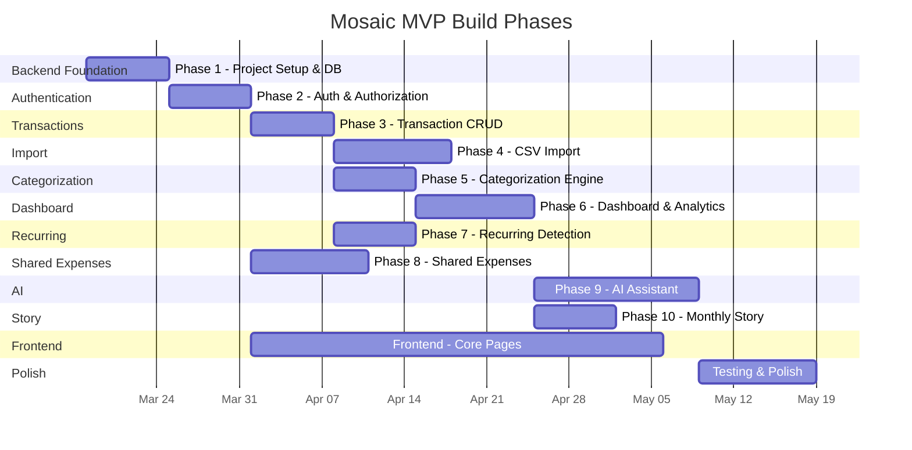

# Mosaic — Implementation Plan

> Phase-by-phase build plan with deliverables, dependencies, and verification criteria.

---

## Overview



---

## Phase 1: Backend Foundation

### Goal
Set up the project skeleton with Spring Boot, PostgreSQL, Docker Compose, database migrations, health endpoints, global error handling, and structured logging.

### Assumptions
- Java 21 and Maven are installed or available via Docker
- PostgreSQL 16 will run in Docker for local development
- No application features — just infrastructure

### Deliverables

| # | Task | Files |
|---|---|---|
| 1 | Initialize Maven project with Spring Boot 3.x | `backend/pom.xml`, `MosaicApplication.java` |
| 2 | Configure PostgreSQL connection | `application.yml`, `application-dev.yml` |
| 3 | Add Flyway + first migration (users table) | `V1__create_users.sql` |
| 4 | Health & readiness endpoints | `HealthController.java` |
| 5 | Global exception handler | `GlobalExceptionHandler.java`, `ErrorResponse.java` |
| 6 | Structured logging (JSON) | `logback-spring.xml` |
| 7 | Correlation ID filter | `CorrelationIdFilter.java` |
| 8 | OpenAPI/Swagger config | `OpenApiConfig.java` |
| 9 | Docker Compose | `docker-compose.yml` |
| 10 | Backend Dockerfile | `backend/Dockerfile` |
| 11 | Environment variable documentation | `docs/ENVIRONMENT_VARIABLES.md` |

### Database Changes
- `V1__create_users.sql` — users table with UUID PK, email, password_hash, timestamps

### Verification
- [ ] `docker compose up` starts PostgreSQL and backend
- [ ] `GET /health` returns `200 OK`
- [ ] `GET /ready` returns `200` when DB is reachable, `503` otherwise
- [ ] Flyway migration runs on startup
- [ ] Swagger UI at `/swagger-ui.html`
- [ ] Structured JSON logs in console
- [ ] Correlation IDs in request/response headers

### Security Review
- Database credentials via env vars, not in source
- No default passwords in committed configs
- Health endpoint does not expose sensitive info

---

## Phase 2: Authentication & Authorization

### Goal
Implement user registration, login, JWT-based authentication, and per-resource authorization.

### Dependencies
- Phase 1 complete

### Deliverables

| # | Task | Files |
|---|---|---|
| 1 | User registration endpoint | `AuthController.java`, `AuthService.java` |
| 2 | Password hashing (bcrypt) | `AuthService.java` |
| 3 | Login endpoint with JWT generation | `JwtTokenProvider.java`, `JwtService.java` |
| 4 | JWT authentication filter | `JwtAuthenticationFilter.java`, `SecurityConfig.java` |
| 5 | Token refresh endpoint | `AuthController.java` |
| 6 | Logout / token revocation | `AuthService.java` |
| 7 | User profile & preferences | `UserController.java` |
| 8 | Rate limiting on auth endpoints | `SecurityConfig.java` |
| 9 | Database migrations | `V2__create_profiles_preferences.sql` |

### Database Changes
- `V2__create_profiles_preferences.sql` — user_profiles, user_preferences tables

### Tests
- [ ] Register with valid data → 201
- [ ] Register with duplicate email → 409
- [ ] Register with weak password → 400
- [ ] Login with valid credentials → 200 + tokens
- [ ] Login with invalid credentials → 401
- [ ] Access protected endpoint without token → 401
- [ ] Access protected endpoint with expired token → 401
- [ ] Token refresh works → new access token
- [ ] User A cannot access User B's data → 403/404

### Security Review
- bcrypt cost factor ≥ 12
- JWT secret from env var, minimum 256 bits
- Short-lived access tokens (15 min)
- Refresh tokens stored/tracked for revocation
- No user enumeration in error messages

---

## Phase 3: Transaction Management

### Goal
Full CRUD API for transactions with filtering, pagination, sorting, and validation.

### Dependencies
- Phase 2 complete

### Deliverables

| # | Task | Files |
|---|---|---|
| 1 | Transaction entity & repository | `Transaction.java`, `TransactionRepository.java` |
| 2 | Create transaction endpoint | `TransactionController.java`, `TransactionService.java` |
| 3 | List with filters & pagination | `TransactionFilterRequest.java` |
| 4 | Get/Update/Delete endpoints | Controller + Service |
| 5 | Money utility (format/parse) | `Money.java`, `MoneyUtils.java` |
| 6 | Input validation | DTOs with Bean Validation |
| 7 | Database migration | `V4__create_transactions.sql` |
| 8 | Categories migration + seed | `V3__create_categories.sql`, `V15__seed_categories.sql` |

### Database Changes
- `V3__create_categories.sql` — categories table with parent_id
- `V4__create_transactions.sql` — transactions table with all fields
- `V15__seed_categories.sql` — ~20 default categories

### Tests
- [ ] Create transaction with valid data → 201
- [ ] Amount stored as BIGINT minor units
- [ ] Invalid currency code → 400
- [ ] Filter by date range works correctly
- [ ] Filter by category, merchant, type
- [ ] Pagination returns correct pages
- [ ] Soft-delete sets deleted_at
- [ ] User A's transactions not visible to User B
- [ ] Transaction types validated against enum

### Example API Call
```
POST /api/v1/transactions
{
  "amountMinor": 4299,
  "currency": "USD",
  "merchantName": "Whole Foods",
  "transactionType": "EXPENSE",
  "transactionDate": "2024-03-15T10:30:00Z"
}
→ 201 Created
```

---

## Phase 4: CSV Import

### Goal
Allow users to upload CSV files, map columns, preview parsed data, detect duplicates, and confirm imports.

### Dependencies
- Phase 3 complete

### Deliverables

| # | Task | Files |
|---|---|---|
| 1 | File upload endpoint | `ImportController.java` |
| 2 | CSV parsing service | `CsvParserService.java` |
| 3 | Column mapping + preview | `ImportService.java` |
| 4 | Duplicate detection | `DuplicateDetectionService.java` |
| 5 | Confirm/commit import | `ImportService.java` |
| 6 | Import history | `ImportController.java` |
| 7 | File hash for idempotency | `TransactionImport.java` |
| 8 | Database migrations | `V5__create_transaction_imports.sql` |

### Database Changes
- `V5__create_transaction_imports.sql` — transaction_imports, transaction_import_rows

### Tests
- [ ] Upload valid CSV → 201 with columns
- [ ] Upload non-CSV file → 400
- [ ] Upload file > size limit → 413
- [ ] Preview shows valid/invalid/duplicate counts
- [ ] Confirm creates transactions in DB
- [ ] Re-upload same file → duplicate detection via file hash
- [ ] Empty CSV → clear error message
- [ ] Malformed rows reported with line numbers
- [ ] Different date formats parsed correctly
- [ ] Negative amounts → EXPENSE, positive → INCOME

---

## Phase 5: Categorization Engine

### Goal
Automatically categorize transactions using merchant aliases and keyword rules, with user corrections feeding back.

### Dependencies
- Phase 3 complete

### Deliverables

| # | Task | Files |
|---|---|---|
| 1 | Merchant alias entity & CRUD | `MerchantAlias.java`, `MerchantAliasService.java` |
| 2 | Categorization service | `CategorizationService.java` |
| 3 | User correction tracking | `UserCorrection.java` |
| 4 | Auto-categorize on transaction create | `TransactionService.java` (update) |
| 5 | Database migrations | `V6__create_merchant_aliases.sql`, `V13__create_user_corrections.sql` |

### Database Changes
- `V6__create_merchant_aliases.sql` — merchant_aliases table
- `V13__create_user_corrections.sql` — user_corrections table

### Tests
- [ ] Known merchant → auto-categorized with confidence
- [ ] Unknown merchant → uncategorized
- [ ] User correction updates category + creates correction record
- [ ] Alias matching is case-insensitive
- [ ] System aliases vs. user aliases priority

---

## Phase 6: Dashboard & Analytics

### Goal
Backend endpoints that return pre-computed financial summaries, category breakdowns, and comparisons.

### Dependencies
- Phases 3 and 5 complete

### Deliverables

| # | Task | Files |
|---|---|---|
| 1 | Financial summary endpoint | `DashboardController.java`, `DashboardService.java` |
| 2 | Spending by category | `DashboardService.java` |
| 3 | Spending by merchant | `DashboardService.java` |
| 4 | Monthly comparison | `DashboardService.java` |
| 5 | Largest transactions | `DashboardService.java` |
| 6 | Currency handling in aggregates | `DashboardService.java` |

### Tests
- [ ] Summary correctly sums income/expense in same currency
- [ ] Transactions in different currencies flagged (not summed)
- [ ] Refunds subtracted from expenses
- [ ] Transfers excluded from income/expense totals
- [ ] Monthly comparison handles months with no data
- [ ] Only current user's data aggregated

---

## Phase 7: Recurring Payment Detection

### Goal
Detect patterns in transaction data that suggest recurring payments (subscriptions, bills).

### Dependencies
- Phase 3 complete

### Deliverables

| # | Task | Files |
|---|---|---|
| 1 | Detection algorithm | `RecurringDetectionService.java` |
| 2 | Candidate entity & storage | `RecurringPaymentCandidate.java` |
| 3 | Subscription confirmation | `RecurringController.java` |
| 4 | Database migration | `V7__create_recurring_and_subscriptions.sql` |

### Database Changes
- `V7__create_recurring_and_subscriptions.sql` — recurring_payment_candidates, subscriptions

### Tests
- [ ] Monthly same-merchant same-amount → detected
- [ ] Similar but not exact amounts → detected with lower confidence
- [ ] One-time purchases → not flagged
- [ ] User confirmation changes status
- [ ] Dismissed candidates not re-detected

---

## Phase 8: Shared Expenses

### Goal
Group creation, expense tracking, splitting, and balance calculation.

### Dependencies
- Phase 2 complete

### Deliverables

| # | Task | Files |
|---|---|---|
| 1 | Group CRUD | `GroupController.java`, `GroupService.java` |
| 2 | Member management | `GroupService.java` |
| 3 | Expense creation with splits | `SharedExpenseRequest.java`, `SplitCalculationService.java` |
| 4 | Balance calculation | `SplitCalculationService.java` |
| 5 | Settlement recording | `GroupController.java` |
| 6 | Database migration | `V8__create_groups_and_shared_expenses.sql` |

### Database Changes
- `V8__create_groups_and_shared_expenses.sql` — groups, group_members, shared_expenses, shared_expense_splits

### Tests
- [ ] Equal split: 100 among 3 = 33, 33, 34 (remainder handling)
- [ ] Percentage split: percentages must sum to 100
- [ ] Balance calculation: net of all expenses
- [ ] Settlement reduces outstanding balance
- [ ] Non-member cannot view group
- [ ] Member removal handles outstanding balances

---

## Phase 9: AI Assistant

### Goal
Natural-language query interface backed by intent classification, safe queries, deterministic computation, and LLM-generated explanations.

### Dependencies
- Phases 3, 5, 6 complete
- AI service scaffolded

### Deliverables

| # | Task | Files |
|---|---|---|
| 1 | AI service project setup | `ai-service/` scaffold |
| 2 | Intent classifier | `classifier.py`, `intents.py` |
| 3 | Safe query templates | `templates.py`, `builder.py` |
| 4 | Data fetcher (read-only) | `fetcher.py`, `connection.py` |
| 5 | LLM provider abstraction | `provider.py`, `mock_provider.py` |
| 6 | Safety guards | `guards.py`, `injection.py` |
| 7 | Backend proxy controller | `AiController.java`, `AiProxyService.java` |
| 8 | Audit logging | `AiQueryAudit.java` |
| 9 | Database migrations | `V10__create_ai_tables.sql` |

### Database Changes
- `V10__create_ai_tables.sql` — ai_conversations, ai_messages, ai_query_audits

### Tests
- [ ] "How much did I spend on food?" → correct total
- [ ] "Compare this month with last month" → correct comparison
- [ ] Prompt injection attempt → refused
- [ ] Request for another user's data → refused
- [ ] Financial advice request → politely declined
- [ ] LLM unavailable → graceful degradation
- [ ] All queries audited

---

## Phase 10: Monthly Financial Story

### Goal
Auto-generate a monthly narrative from structured financial data.

### Dependencies
- Phase 6 complete

### Deliverables

| # | Task | Files |
|---|---|---|
| 1 | Monthly summary entity | `MonthlySummary.java` |
| 2 | Story generation service | `MonthlyStoryService.java` |
| 3 | Story API endpoints | `InsightController.java` |
| 4 | Database migration | `V11__create_insights_and_summaries.sql` |

### Database Changes
- `V11__create_insights_and_summaries.sql` — financial_insights, monthly_summaries

### Tests
- [ ] Story generated with correct totals
- [ ] Month-over-month comparison accurate
- [ ] Story includes top categories
- [ ] Story handles months with no data
- [ ] Regeneration updates existing record

---

## Frontend Phases (Parallel Track)

### FE Phase A: Foundation (During Backend Phases 1–2)
- Vite + React + TypeScript project setup
- Tailwind CSS configuration
- Design system (colors, typography, spacing)
- Common components (Button, Input, Card, Modal)
- Layout (Sidebar, Header, responsive shell)
- Auth pages (Login, Register)
- API client with JWT interceptor
- Route protection

### FE Phase B: Core Features (During Backend Phases 3–5)
- Transaction list with filters
- Transaction create/edit form
- CSV import wizard (upload → map → preview → confirm)
- Category management
- Onboarding flow

### FE Phase C: Dashboard & Insights (During Backend Phases 6–7)
- Dashboard page with all widgets
- Charts (category breakdown, monthly comparison)
- Recurring payment radar
- Subscription management

### FE Phase D: Social & AI (During Backend Phases 8–9)
- Shared expense groups
- Group detail + balance view
- AI assistant chat interface
- Evidence panel

### FE Phase E: Polish (During Backend Phase 10)
- Monthly story viewer
- Settings page
- Privacy & data controls
- Empty states, loading states, error states
- Accessibility audit
- Responsive design audit
- Landing page

---

## Cross-Cutting Concerns (Throughout All Phases)

| Concern | Approach |
|---|---|
| **Testing** | Unit + integration tests per phase; E2E tests in polish phase |
| **Documentation** | Update API docs and README after each phase |
| **Security** | Threat review per phase |
| **Logging** | Structured JSON + correlation IDs from Phase 1 |
| **Monitoring** | Health + readiness from Phase 1; metrics in polish phase |
| **CI/CD** | GitHub Actions from Phase 1; expand per phase |
| **Sample Data** | Build seed scripts incrementally |

---

## Approval Gates

Each phase requires explicit approval before moving to the next. At each gate:

1. ✅ All deliverables implemented
2. ✅ Tests passing
3. ✅ Documentation updated
4. ✅ Security review complete
5. ✅ Demo / example API calls verified
6. ✅ No regressions in previous phases
